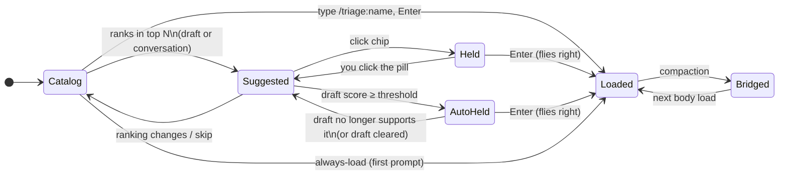
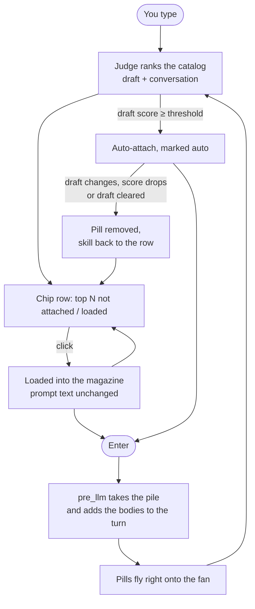
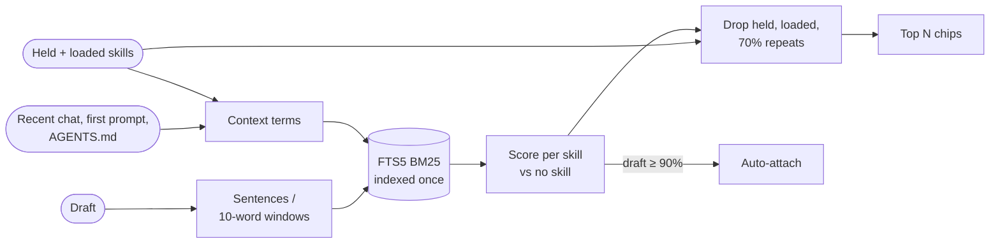
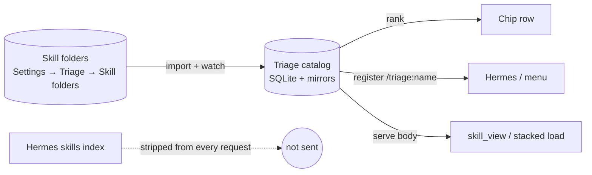

# How Triage works (target behavior)

This is the behavior spec. When code and this file disagree, the code is wrong.
It replaces the chip rules in `CASE.md` where they differ (clicking a chip no
longer sends the prompt).

## Premise

Skills stay out of the context window. Triage keeps the whole catalog (any
number of skills) in its own store and searches it at runtime against what you
type and what the conversation is about. A skill enters the context only when
you attach it, or when it scores above the auto-attach threshold. Harness
skills that must always be present go on the always-load list.

## The three places a skill can be

| Place | Where you see it | How it gets there | How it leaves |
| --- | --- | --- | --- |
| **Suggested** | Chip row above the prompt (left) | The judge ranks it in the top N for the draft or the conversation | You attach it, or the ranking changes |
| **Held** | Blue ⚡ pills in the magazine, left of the chips. The prompt text is not changed | You click its chip, or auto-attach (≥ threshold). (A typed `/triage:name` token loads the same way but stays in the text) | You click the pill, or (auto-attached only) the draft stops supporting it |
| **Loaded** | Fan on the right of the prompt | You send a prompt while it is held (it flies from the left pile onto the fan), or always-load | Never during the session. After compaction it is kept as a bridge (name + description) |

## Rules

1. **Clicking a chip never sends.** It loads the skill into the *magazine*:
   one fixed slot left of the chips. The newest pill sits in the slot and
   every earlier one is pushed up behind it, condensing as the stack grows,
   with a count badge. The chip row never changes width. Hover spreads the
   stack upward; click a pill to take it out. The prompt text is never edited.
   Load several, then press Enter once.
2. **No limit on held skills** (`max_attached`, default 0 = unlimited; set a
   number to cap it). Held skills are not prompt tokens, so Hermes' 5-token
   stacked limit does not apply. One limit is Hermes': a plugin may add about
   10,000 characters to a turn before Hermes moves the text to a file and
   leaves a preview. Triage inlines held skills up to ~8,000 characters (what
   always-load did not use); every further skill is named in that block with
   an instruction to load it with `skill_view` before answering, and Triage
   serves it in full. Those are fetched by the model, but not chosen by it.
3. **The row always shows N chips** (`shortlist_size`, default 5) while
   anything ranks: attached and loaded skills are excluded, so the row refills.
4. **Auto-attach.** When a skill supported by the *draft* reaches
   `auto_accept_threshold` (default 0.90) and the draft gives real evidence
   for it, Triage attaches it for you and marks it auto. Evidence is read from
   the prose of the draft only: paths, `@file` / `@folder` references, code
   and URLs do not count. It is either the full name of a skill whose name has
   two or more words (`android-cli`), or words of the skill's name or
   description that are rare in the catalog. Rarity is
   `ln(skills / skills holding the word)` summed over the matched words, and
   3.0 is enough: `firebase` attaches on its own, while `go`, `build` or
   `issues` are shown as chips and wait for a click. Catalogs under 200 skills
   cannot measure rarity, so any name or description word counts there.
   A body sentence or BM25 strength alone never auto-attaches.
   Conversation chips never auto-attach.
5. **Auto-detach.** An auto-attached skill leaves the pile as soon
   as the draft no longer supports it: its draft score falls below the
   threshold minus 0.10, or the draft is cleared. It returns to the row if it
   still ranks, else it disappears. Skills you attached yourself are never
   removed for you.
6. **Enter sends the prompt with the pile.** The pile lives in Triage's
   backend (`POST /attach`), never in the prompt. When the message reaches the
   agent, Triage's `pre_llm` hook takes the pile and adds the skill bodies to
   that turn. On screen the chips hide while the reply runs, the magazine
   empties right onto the fan, and the chips come back re-ranked when the
   reply ends. The fan condenses as it fills (it stays within a fixed width),
   so its density shows how much skill context the chat carries. When a
   message carries held skills, Triage adds no shortlist of its own to that
   turn.
   On desktop the magazine is the only way a skill loads: a turn with an empty
   magazine gets nothing from Triage (no list for the model, no server-side
   auto-load), so a skill you took out of the magazine stays out. Chats on
   platforms without chips (Telegram, CLI) keep the server's own ranking.
7. **Plugin only.** Triage never edits Hermes' files, settings or message
   rendering, and uses only plugin APIs (hooks, middleware, REST, the
   composer area and its SDK calls). It does read the composer's DOM to place
   its overlay and as a fallback for the draft text; a Hermes UI redesign can
   move the overlay, but cannot break loading. The cost: Hermes'
   sent-message bubble shows no ⚡ chip for held skills; the right fan does.
8. **The row never disappears on its own.** With an empty prompt it shows what
   the conversation is about (recent turns, the first prompt and its
   attachments, the workspace's AGENTS.md / README). Those chips are dashed.
   While you type, N − 2 chips come from the draft and 2 from the conversation.
9. **Search all skills, and "none for this message".** A **magnifier button**
   stands between the magazine and the chips. It
   opens a list above the chips at the left edge (downward when there is no
   room above), drawn with Hermes' own popover; its search field carries the
   same markers as Hermes' Ctrl+K palette, so a theme styles both alike. The
   list keeps one size. With an empty search field it shows at most 5 "Most
   used" and as many "Suggested" as the chip row shows. It
   has its own search field over the whole catalog, scrolls, and takes the
   arrow keys; clicking a row holds the skill or takes it out again, and the
   list stays open. With an empty search field it shows three groups:
   **Favourites**, **Most used**, **Suggested**. Every row starts with a
   **star**; clicking it makes the skill a favourite or removes it. A star
   only decides what the empty list shows: it does not attach a skill and
   does not change the ranking. The list opens only from the magnifier, never
   by typing. Hermes' own floating things win over the bar: its `/` menu
   covers the part of the bar it overlaps, and that menu never moves the bar.
   The bar stands right above Hermes' composer dock and does not move while
   you scroll; Hermes' "N messages" jump button is lifted by the bar's height
   so it shows above the bar (only while the bar shows). A **trash button** left of
   the magazine removes every held skill and locks the magazine for this
   message: chips are greyed, nothing can be held and nothing auto-attaches.
   The lock button, or sending the message, lifts it.
10. **Slash search covers the whole catalog.** Every catalog skill is
   registered with Hermes as `/triage:<name>`, so Hermes' own `/` menu finds
   it. A typed token stays in the prompt text (it does not join the
   magazine); Hermes or Triage loads it with the message, the same way.
11. **The fan also lists what Triage did not load.** Skills the chat loaded
   before Triage was there, or that Hermes or the agent loaded by themselves,
   are read from the chat's history and shown on the fan. The fan shows only
   what is in context now: a skill whose text was lost at a compaction leaves
   the fan, and it can be suggested, picked and attached again. Each chip on
   the fan is as wide as its name; names are cut only when the fan runs out
   of room. The bar stands above everything Hermes stacks on the prompt
   (goal, changed files, queued messages).
12. **A chat keeps its skills when Hermes gives it a new id.** Hermes replaces
   a chat's session id when it continues an ended chat or compacts it. The
   magazine and the fan are looked up under every id of the same chat.
13. **Keep after compaction.** The skill card has a **Keep** button. A kept
   skill whose text left the context at a compaction goes back into the
   magazine by itself, once per compaction, and loads with the next message.
   It never comes back while the magazine is locked, and it counts toward
   the per-message limit.

## How the chips are ranked

No model decides. The catalog is indexed once (SQLite FTS5/BM25 at import),
held in memory per process, and searched like a search engine on every pause
in typing (~0.2 s per keystroke on 2,584 skills).

1. **Chunks, not the whole draft.** The draft is cut into sentences, long ones
   into ~10-word windows (max 6). Each chunk is searched on its own and the
   best score per skill wins, so "android crash … research on X … agents in
   the background" brings skills for every topic. Chunks already searched are
   cached, so typing only pays for the chunk you are in.
2. **Each skill scores on its own** (its match strength against "no skill"),
   not as a share of one pie. Several strong matches can all be high, and each
   can clear the auto-attach threshold by itself. The server's turn decision
   for non-desktop platforms still uses the shared score (one best skill).
3. **Context.** Besides the draft: a recent window of the chat (last 3 user
   messages, replies and tool reads), the first prompt and its attachments,
   the workspace's AGENTS.md / CLAUDE.md / README, and the descriptions of
   held and loaded skills. That last part lets the chips daisy-chain to skills
   that complement what you already loaded.
4. **No repeats.** Held, typed and loaded skills never come back as chips, and
   the server refills the row past them. A candidate whose name and
   description overlap a held or loaded skill by 70% or more is dropped unless
   the draft supports it at 95% or more.

## Open questions and known gaps

- **Typos (done, simple).** A word of 4+ letters that occurs nowhere in the
  catalog is replaced by the closest skill name/description/tag word (80%
  similar or more) before searching: "andriod" finds android. Misspellings
  that happen to exist somewhere in a skill body are not corrected.
- **The model re-loading an injected skill (handled).** Held skills' full text
  is in the turn; the header says not to call `skill_view` for them, and if
  the model does, it gets a short "already loaded" answer instead of the body
  again, until the next compaction.
- **Auto-attach calibration (measured 2026-11-11).** `python run.py eval`
  measures the ranking and auto-attach on labelled drafts (see DEVELOPMENT.md).
  On 94 labelled real drafts and 2,586 skills, auto-attach was right 27 of 63
  times before the evidence rule of Rule 4 and 15 of 20 times with it; drafts
  that want no skill got one attached 9 of 51 times before and 1 of 51 with
  it. The rule's cut-off (3.0) was chosen on those same drafts. Skills named
  after a common word (`commit`, `documentation`) no longer attach on their
  name alone; using the pick history to let them is still open.
- **Stale conversation topic (open).** After a change of topic the earlier
  topic's skill can outrank the skill the new draft describes. See scenario D
  in `docs/testing/conversation-tests.md`.
- **What the model may load on its own: through two tools.** No list of
  skills is put in front of the model and `skill_view` stays blocked for
  skills nobody loaded. Instead it has `skill_search(query)` (names and
  one-line descriptions, loads nothing) and `skill_load(names)` (full text;
  the skills join the fan). Cost: ~200 tokens of tool schema; nothing more
  until called. Setting `model_tools` turns them off.
- **Two auto paths (resolved).** On desktop only the magazine loads skills;
  the server's own auto-load and shortlist run only where there are no chips.
- **Very large piles (resolved).** The server looks up the held pile and the
  loaded skills of the chat itself; the desktop sends only typed tokens.
- **New chats.** The first message of a brand-new chat takes the newest pile
  saved in the last 10 minutes (no stored session id yet); two windows
  composing new chats at once could swap piles.

## Connecting skill folders

The catalog is the single place skills come from. You connect folders in the
extension, not in Hermes.

- **Skill folders** (plugin setting): one path per line, anywhere on the PC
  (Hermes' folder, `~/.claude/skills`, a Git checkout, a plugin cache).
  Nothing is connected automatically.
- **Bridges, not copies.** A connected folder is indexed where it lives: the
  catalog keeps each skill's text (for search) and its folder path, and reads
  files from there. Nothing is copied or moved. Edits by the model change the
  original file; Triage never deletes a folder it only indexes. (Only the old
  `migrate` command, which moves skills out of Hermes, keeps a copy.)
- **Live sync (watcher):** Windows reports every change under a connected
  folder as it happens; about 1.5 s after changes stop, the touched skills
  are indexed (new, edited, even deep in `references/`, or deleted). A full
  check every 10 minutes catches anything missed. Folders added in the
  settings are picked up without a restart; an unplugged drive never empties
  the catalog; skills imported any other way are never removed. New skills
  reach Hermes' `/` menu after a gateway restart; chips, search and loading
  see them at once.
- **Skills the model creates** go through Hermes' own `skill_manage` into
  Hermes' skills folder (they are Hermes'); that chat may view and edit them.
  With Hermes' skills folder connected, they appear in the chips within
  seconds.
- **Registration:** each catalog skill is registered with Hermes as a plugin
  skill (`/triage:<name>`), served from its own folder. Hermes' own slash
  menu and stacked loader therefore work for all of them.
- **Atomic search:** typing `/term` turns the chip row into a skill search
  (name start, name part, inside the name, typo-tolerant, then description;
  under 0.1 s). Picking a hit holds it and removes the typed `/term`.
  Hermes' own `/` menu still opens; Triage cannot change it.
- **The index stays out:** plugin skills would appear in Hermes'
  `<available_skills>` index; the strip middleware removes that block from
  every outbound request, so registering costs no context.
- **Hermes' own `skills.external_dirs`** is no longer needed once a folder is
  connected in Triage. Remove it from Hermes (`migrate --apply-config`) to
  avoid duplicate entries in the `/` menu.

## Always-load

Global list (setting) plus `.hermes/triage.yaml` per project. Loaded on a
session's first prompt and again after compaction. They go straight to
*Loaded* and never appear as chips.

## Settings

| Setting | Default | Meaning |
| --- | --- | --- |
| `shortlist_size` | 5 | Chips in the row |
| `max_attached` | 0 | Cap on skills held for one message; 0 = no limit |
| `auto_accept_threshold` | 0.90 | Draft score that auto-attaches. 0 turns auto-attach off |
| `skill_folders` | empty | Folders Triage imports and keeps in sync |
| `always_load` | empty | Skills loaded on every first prompt |
| `strip_skills_index` | on | Remove Hermes' skills index from requests |
| `debug` | off | `[triage-diag]` lines in desktop.log |

## Testing

A clean machine (Windows Sandbox or a VM) with Hermes Desktop installed:

1. Install Triage from the repo (junctions per `DEVELOPMENT.md`).
2. Connect `examples/demo-skills` as a skill folder and Sync.
3. Type `review the commit message`: chips appear, nothing auto-attaches.
4. Click `git-commit`: a ⚡ pill appears on the left, the chip leaves, the next chip steps in, the prompt text is unchanged, nothing is sent.
5. Type `please run git-commit on the staged diff`: `git-commit` auto-attaches.
   Clear the prompt: the pill disappears.
6. Hold two skills, press Enter: the chips hide, both pills fly onto the right
   fan, and the model receives both bodies.
7. Type `/triage:` : the `/` menu lists every catalog skill.
