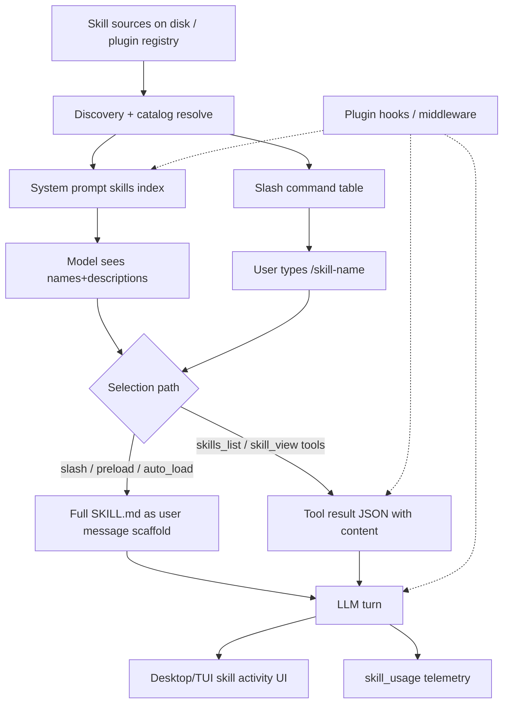

<!-- Vendored from the Hermes v0.22.7 checkout used to design this plugin. Not executed. The plugin does not patch these files. -->

# Hermes Agent Skill Pipeline Map

- **Hermes version:** v0.22.7  
- **Commit:** `b200f5bc60e31588ba2cb60e288029c4a54ba5fa`  
- **Checkout:** `/home/box/.hermes/hermes-agent`  
- **Mapped:** 2026-11-05  
- **Purpose:** Reference for designing a plugin that strips skills from the prompt and replaces them with a runtime judge + tappable probability UI.

This document is derived from reading the checkout source. Code wins over docs.

---

## High-level pipeline



Numbered flow:

1. **Seed/sync** bundled skills into `~/.hermes/skills/` (`tools/skills_sync.py`).
2. **Discover** SKILL.md trees across search roots + plugin-registered skills.
3. **Resolve** name collisions via tier precedence (`agent/skill_utils.resolve_skill_catalog`).
4. **Index** names+descriptions into the system prompt (`build_skills_system_prompt` → volatile tier).
5. **Optionally pin** full bodies via `skills.auto_load` / CLI `-s` preload / slash commands.
6. **Model selects** via `skill_view` / `skills_list` (or follows pinned bodies).
7. **Inject** full SKILL.md into context (user message or tool result).
8. **Surface** activity in Desktop run-summary; **record** usage via `tools/skill_usage.py`.
9. Mid-session catalog changes ride **skills index delta notes** on the user-message channel (not a prompt rebuild).

---

## 1. Discovery and registration

### 1.1 Paths and roots

| Role | Path / API | Notes |
|------|------------|--------|
| Profile skills home | `get_skills_dir()` → `{HERMES_HOME}/skills` (`hermes_constants.py`) | Default `~/.hermes/skills` |
| Bundled source | repo `skills/` (or `HERMES_BUNDLED_SKILLS`) | Synced into profile skills |
| Optional skills | `optional-skills/` via sync helpers | Install-on-demand style |
| Project skills | `<git-root>/.hermes/skills`, `<git-root>/.agents/skills` | Only if root in `skills.trusted_project_dirs` |
| Create dir | `skills.create_dir` config | Agent-created skills landing zone |
| External dirs | `skills.external_dirs` config | Additional scanned roots |
| Plugin skills | PluginManager `_plugin_skills` registry | **Not** copied under `~/.hermes/skills/` |

**Tier precedence** (`agent/skill_utils.py`, `TIER_*`):

```
TIER_PROJECT (0) > TIER_LOCAL (1) > TIER_CREATE_DIR (2) > TIER_EXTERNAL (3)
```

Shared by: skills list, prompt index, slash commands, `skill_view`, preload, cron  
(`get_skill_search_roots`).

Same-tier different skills sharing a name → **ambiguous** (refused, never guessed).  
Higher tier shadows lower → status `shadowed`.

### 1.2 Sync (bundled → profile)

**File:** `tools/skills_sync.py`  
**Entry:** `sync_skills(quiet=False) -> dict`

- Discovers bundled SKILL.md trees, hashes dirs, installs/updates into `{HERMES_HOME}/skills`.
- Manifest at profile skills root tracks provenance.
- Respects curator-suppressed names, `.no-bundled-skills` (essential-only), external-index deferral.
- Related: `tools/skills_sync_bundled_ops.py`, `tools/skills_sync_optional.py`.

### 1.3 On-disk scan / catalog

**File:** `tools/skills_tool.py`

| Function | Role |
|----------|------|
| `skill_search_dirs()` | Live roots via `get_skill_search_roots` |
| `_skill_catalog(...)` | Scan every SKILL.md, parse frontmatter, `resolve_skill_catalog`, cache by tree signature |
| `find_all_skills()` | Loadable `{name=load_name, description, category}` |
| `skills_list(...)` | Tool: JSON list + plugin skills from `list_plugin_skill_metadata()` |
| `locate_skill(...)` | Resolve one name across roots (precedence + quarantine) |
| `skill_view(...)` | Load full SKILL.md / linked file as JSON |

**File:** `agent/skill_utils.py`

| Function | Role |
|----------|------|
| `parse_frontmatter` / `extract_skill_description` / `clip_skill_description` | Metadata for index |
| `skill_matches_platform` / `_environment` / `_apps` | Offer-time gates |
| `extract_skill_conditions` | `requires_*` / `fallback_for_*` / `session_platforms` |
| `get_disabled_skill_names` | `skills.disabled` (+ per-platform) |
| `iter_skill_index_files` / `iter_project_skill_files` | Walkers (project uses quarantine chokepoint) |
| `resolve_skill_catalog` | Annotate `load_name`, `status` ∈ {unique, ambiguous, shadowed} |
| `normalize_skill_lookup_name` / `parse_qualified_name` | Lookups and `plugin:skill` |

### 1.4 Plugin skill registration

**APIs:**

- `PluginContext.register_skill(name, path, description="", frontmatter=None)`  
  (`hermes_cli/plugins_content.py`) → stores under `plugin_or_slug:name`.
- Portable / Agent Plugins: `hermes_cli/plugins_loader._load_portable_plugin` auto-registers each `skills/*/SKILL.md` via `ctx.register_skill`.
- Native plugins: `register(ctx)` may call `ctx.register_skill` manually.
- Listing: `PluginManager.list_plugin_skill_metadata()`, `find_plugin_skill(qualified)`, `list_plugin_skills(namespace)`.

Plugin skills appear in:

- `skills_list` (appended after disk skills)
- system prompt under category **`plugin`** (`_plugin_skill_prompt_rows`)
- slash table via `get_plugin_skill_commands()` (interactive surfaces)

They are **not** written into `~/.hermes/skills/`.

### 1.5 Slash command registration

**File:** `agent/skill_commands.py`

| Function | Role |
|----------|------|
| `scan_skill_commands()` | Walk search roots → `{"/slug": {name, description, skill_md_path, skill_dir}}` |
| `get_skill_commands()` / `get_interactive_skill_commands()` | Cached tables (+ plugin skills for interactive) |
| `skill_command_collision_note` | Skip auto `/slug` if core command owns the name; use `/skill <name>` |
| `resolve_skill_command_key` | Map typed `/foo` → table key |

CLI dispatch: `cli.py` `_run_skill_slash_command` → `build_skill_invocation_message` / stacked variant.

---

## 2. System prompt skills index

### 2.1 Assembly tiers

**File:** `agent/system_prompt.py`

`build_system_prompt_parts` → three tiers joined by `build_system_prompt`:

| Tier | Skills-related content |
|------|------------------------|
| **stable** | Help-guidance variant depending on whether `hermes-agent` is in the index; **`skills.auto_load` full bodies** via `_auto_load_parts` |
| **context** | Caller `system_message`, project context files (not the skills index) |
| **volatile** | **`_skills_prompt` → `build_skills_system_prompt`** (the `<available_skills>` index), memory, plugin sections, profile/timestamp/env |

Important: the **index** is volatile (mutable catalog). **Pinned auto_load bodies** are treated as stable constants for the agent lifecycle.

### 2.2 `_skills_prompt` gate

```python
# agent/system_prompt.py::_skills_prompt
# Empty unless skills_list / skill_view / skill_manage are in valid_tool_names
return build_skills_system_prompt(
    available_tools=..., available_toolsets=...,
    compact_categories=coding_compact_skill_categories(...),
    skills_dir_override=_agent_skills_dir(agent),
)
```

Safe workers (`safe_worker_enabled`) get an empty skills prompt.

### 2.3 `build_skills_system_prompt`

**File:** `agent/prompt_builder.py`

| Function | Role |
|----------|------|
| `build_skills_system_prompt` | Public entry; home override for multi-profile safety |
| `_build_skills_system_prompt_inner` | Manifest/snapshot/cache, scan+resolve, plugin rows |
| `_render_skills_index` | Emit `## Skills` + guidance + `<available_skills>` |
| `_plugin_skill_prompt_rows` | Enabled plugin skills |
| `clear_skills_system_prompt_cache` | Invalidate in-process LRU (+ optional disk snapshot) |

**What is injected (exactly):**

- Category headers (path relative under skills root, or `general` / `plugin`)
- Per skill: `- {load_name}: {description}` (description clipped)
- Project skills prefixed `[project] ` in description
- Coding focus: some categories demoted to **names only** (`compact_categories`) — never hidden
- Guidance prose instructing the model to `skill_view(name)` when relevant
- Oneshot sessions: alternate load-guidance wrapper (`ONESHOT_SKILLS_LOAD_GUIDANCE`)

**Not** in the index: full SKILL.md body, tags (tags appear in `skill_view` JSON), scripts.

Disk snapshot: `{HERMES_HOME}/.skills_prompt_snapshot.json` for cold-start reuse.

### 2.4 Mid-session index deltas

**File:** `agent/skills_index_delta.py`  
**Entry:** `stage_skills_index_note(agent, prompt, conversation_history)`

Because the system prompt is frozen for prefix-cache warmth, installs/creates/removes after build are announced on the **user-message note channel** (`consume_skills_index_note` in `turn_context._merge_gateway_notes`), not by rewriting the system prompt every turn.

---

## 3. Selection paths

### 3.1 Slash commands

1. User types `/skill-name [instruction]` (or stacked `/a /b do X`, max 5).
2. `cli.py` / TUI slash worker resolves via `get_interactive_skill_commands`.
3. `build_skill_invocation_message` / `build_stacked_skill_invocation_message`:
   - `_load_skill_payload` → read+parse skill
   - `_render_skill_block` → `bump_use` + `_build_skill_message`
4. Resulting text becomes the **user message** for the turn (activation note + full content + skill dir + supporting-file hints).
5. History UIs may re-expand for display (`tui_gateway/session_history.py`).

Native/gateway: plugin skills are interactive-only (`interactive=False` skips them in stacked resolve).

### 3.2 Model tools: `skills_list` / `skill_view`

**Registration:** `tools/skills_tool.py` bottom — `registry.register` into toolset `skills`.

| Tool | Handler | Output |
|------|---------|--------|
| `skills_list` | `skills_list(category=...)` | JSON `{skills, categories, count, hint}` |
| `skill_view` | `_skill_view_with_bump` → `skill_view` | JSON `{success, name, description, tags, content, linked_files, readiness_*, ...}` |

Flow for `skill_view`:

1. Path/namespace validation (`skill_lookup_path_error`).
2. If `:` → plugin registry (`_resolve_plugin_skill` / `_serve_plugin_skill`).
3. Else `locate_skill` across roots.
4. Read SKILL.md; platform/disabled checks; optional `file_path` for linked resources.
5. Optional preprocess (templates / inline shell) via `_preprocess_skill`.
6. Env/cred readiness (`_skill_readiness`); `pm.ensure` for frontmatter `deps`.
7. On success: `bump_view` + `bump_use`; session dedup stub via `dedup_skill_view`.

The tool result (including full `content`) is the normal tool-message in the conversation — that is how the body enters context for the tool path.

### 3.3 Auto-load / preload

| Mechanism | Config / CLI | Builder | Injection site |
|-----------|--------------|---------|----------------|
| **auto_load** | `skills.auto_load: [names...]` in config.yaml | `build_auto_load_prompt` | Stable system-prompt tier (`_auto_load_parts`), once per agent lifecycle |
| **preload** | CLI/TUI `-s` / session skill flags | `build_preloaded_skills_prompt` | Session start user/system scaffold (excludes names already auto-loaded) |

Both use `_load_skill_blocks` → `_render_skill_block` (full bodies).  
Disabled skills count as missing (do not force-load).  
`HERMES_IGNORE_RULES` / `skip_context_files` / missing skills toolset → auto_load skipped.

There is **no** separate `always_load` symbol in this checkout; **auto_load** is the persistent pin, **preload** is the session pin.

---

## 4. Context injection details

### 4.1 Full body formats

**Slash / auto / preload** (`_build_skill_message` in `skill_commands.py`):

- Activation note (IMPORTANT: …)
- Preprocessed SKILL.md body (`preprocess_skill_content` / `agent/skill_preprocessing.py`)
- `[Skill directory: …]` absolute path
- Optional config-var injection, setup notes
- Supporting files list + `skill_view(name, file_path=…)` hint

**Tool path:** JSON string tool result with `"content": "<full SKILL.md>"` (and metadata). Dedup may replace repeated identical views with a short stub until compression clears the cache.

### 4.2 Ephemeral per-turn injection (plugins)

`agent/turn_context.py::_collect_pre_llm_call_context`:

- Invokes `pre_llm_call` hooks.
- Returns concatenated `context` strings → appended to the **user message** (never the system prompt).
- `{"action":"block","message":...}` ends the turn before inference (`PRE_LLM_BLOCK_EXIT_REASON`).
- Oversized hook context may spill to disk (`tools/hook_output_spill.py`).

Also merged onto the user channel: gateway notes, plugin notices, surface-switch notes, **skills index delta** notes.

### 4.3 Plugin system-prompt sections

`ctx.register_system_prompt_section(id, content|callable, position="after_memory", max_chars=...)`  
Rendered into the volatile tier after memory (`_plugin_section_blocks`). Bounded; frozen per session until compression invalidates.

**This adds sections; it does not remove the core skills index.**

---

## 5. UI / activity surfaces

### 5.1 Desktop skill activity

**Files:**

- `apps/desktop/src/components/assistant-ui/tool/skill-activity.ts`  
  `skillActivityTitle(part)` — titles for `skill_view` / `skills_list` (loading / listed / reading resource / failures).
- `apps/desktop/src/components/assistant-ui/tool/run-summary.ts`  
  `summarizeToolRun` — skill clauses via `skillActivityTitle`; `toolPresentVerb('skill_view')` → “Loading…”.
- Also used from `fallback-model/index.ts`, tool-group, message stream.

Activity is **derived from tool-call parts** in the transcript (args `name` / `file_path`, pending/result). There is no separate “probability chip” UI in core.

### 5.2 Skills management UI (not turn activity)

Under `apps/desktop/src/app/capabilities/skills/` and `catalog/` — install/detail/provenance; separate from runtime selection.

### 5.3 Usage / curator telemetry

**File:** `tools/skill_usage.py`

| API | When |
|-----|------|
| `bump_view` | Successful `skill_view` |
| `bump_use` | Successful view (treated as active use) + slash/auto/preload load |
| `record_created` / `record_installed` / archive / suppress | Lifecycle |
| Storage | `{HERMES_HOME}/skills` usage file (locked) |

Feeds curator lifecycle (stale timers, prune eligibility). Desktop “activity” for curation is this store + catalog UI, not the chat run-summary.

### 5.4 TUI

`ui-tui` / `tui_gateway` expose skills hub, slash discovery (`command_discovery.py`), and history expansion for slash-invoked skills. Same underlying `agent.skill_commands` / tools.

---

## 6. Plugin interception matrix

### 6.1 Registration APIs (actual)

From `hermes_cli/plugins.py` / loaders:

| API | Purpose |
|-----|---------|
| `register(ctx)` in plugin `__init__.py` | Entry |
| `ctx.register_hook(name, cb, hold_stream=False)` | Lifecycle hooks (`VALID_HOOKS`) |
| `ctx.register_middleware(kind, cb)` | `VALID_MIDDLEWARE`: `tool_request`, `tool_execution`, `llm_request`, `llm_execution` |
| `ctx.register_tool(...)` / tools module `register_tools(ctx)` | New tools (override needs `allow_tool_override`) |
| `ctx.register_skill(...)` | Plugin-owned skills |
| `ctx.register_system_prompt_section(...)` | Extra prompt blocks |
| `ctx.ask_choice(question, choices)` | Sync slash-handler choice picker (`plugin_choices.py`) |
| `invoke_hook` / `has_hook` | Core fire sites |

### 6.2 Relevant `VALID_HOOKS` (skills-related)

| Hook | Fire site (summary) | Can affect skills? |
|------|---------------------|--------------------|
| **`pre_llm_call`** | `turn_context._collect_pre_llm_call_context` | Inject user-message context; **block** turn. **Best place for a runtime judge shortlist.** Does **not** strip system prompt index. |
| **`post_llm_call`** | After model response | Observe / transform? (observer-ish; see dispatch docs) |
| **`pre_tool_call`** | Before tool exec | **Block** `skill_view`/`skills_list`; rewrite via paired middleware |
| **`post_tool_call`** | After tool | Observe skill loads |
| **`transform_tool_result`** | After tool | Rewrite skill_view JSON (e.g. truncate / annotate) |
| **`transform_llm_output`** | Stream/output transform (`hold_stream=True` supported) | Could append UI directives in text; not first-class chips |
| **`on_skill_lifecycle`** | `skill_usage` emit path | Observe create/install/view/use/archive |
| **`pre_command`** | Before recognized slash | Observe `/skill` (v1 returns ignored) |
| **`on_session_start` / `on_session_end`** | Session bounds | Init judge DB / cleanup |
| **`on_human_input_request` / `_resolved`** | Human prompts | Adjacent to choice UX |
| **`pre_api_request` / `post_api_request`** | Provider HTTP | Last-chance payload peek (heavy; prefer `llm_request` middleware) |

`pre_llm_call` return shapes (from `plugins_dispatch.invoke_hook` docstring + `turn_context`):

- `{"context": "..."}` or bare `str` → inject into user message  
- `{"action": "block", "message": "..."}` → veto turn  

### 6.3 Middleware

| Kind | Effect for skills plugin |
|------|--------------------------|
| **`llm_request`** | `apply_llm_request_middleware` in `agent/turn_api_request.py` — can replace provider `api_kwargs` (messages/system). **Possible** last-mile strip/replace of skills index in the outbound request, but fights prefix-cache / frozen prompt assumptions; fragile across providers. |
| **`tool_request`** | Rewrite `skill_view` args before execution |
| **`tool_execution` / `llm_execution`** | Wrap execution |

### 6.4 Matrix by pipeline step

| Pipeline step | Intercept / replace? | Practical hook |
|---------------|----------------------|----------------|
| Bundled sync | No plugin hook | N/A (install-time) |
| Disk discovery | No direct override | External dirs / project skills / disable lists |
| Plugin skill registration | Yes | `ctx.register_skill` |
| System prompt **index build** | **No dedicated strip hook** | Workarounds: disable skills tools (hides index), empty `skills` dirs, or **`llm_request` middleware** rewrite of outbound system message |
| Auto_load bodies | Config only | Clear `skills.auto_load`; cannot hook-strip mid-build cleanly |
| Slash selection | `pre_command` (observe); own slash via `register` commands | Replace UX with plugin command + `ask_choice` |
| `skills_list` / `skill_view` | `pre_tool_call` block; `tool_request` rewrite; `transform_tool_result` | Gate loads until user confirms |
| Body → context (tool) | `transform_tool_result` | Annotate / gate content |
| Body → context (slash/auto) | Limited | Prefer not using those paths; or block at `pre_llm_call` after detecting scaffold |
| Per-turn judge injection | **Yes** | **`pre_llm_call` → `{context: scored shortlist}`** |
| User tappable confirm | Partial | **`ctx.ask_choice`** (slash handlers); Desktop custom plugin UI / `on_human_input_*`; no core “probability chip” API |
| Activity UI | Read-only from tool parts | Emit synthetic tool events only if you register tools that the Desktop already titles — or ship Desktop plugin UI |
| Usage telemetry | `on_skill_lifecycle` | Observe |

### 6.5 Recommended hook plan for “strip index + runtime judge + tappable probability UI”

1. **`pre_llm_call`** — atomic search over skill DB; inject short probability-tagged candidate list into user context; optionally `{action:"block"}` until user picks (pairing with a choice surface).
2. **`llm_request` middleware** *(optional, careful)* — strip/replace `## Skills` / `<available_skills>` in the outbound system message so the main model does not see the full index (document cache-break side effects).
3. **`pre_tool_call` on `skill_view`** — refuse loads that were not user-approved / judge-selected.
4. **`ctx.ask_choice` or Desktop plugin UI** — present tappable scored skills (core Desktop has no probability-chip primitive; `ask_choice` is the built-in picker for plugin slash flows).
5. **`register_tool` + `allow_tool_override` only if necessary** — e.g. wrap `skill_view`; prefer hooks over overriding builtins.
6. **`on_skill_lifecycle` / `post_tool_call`** — learn from accepted loads for the judge.
7. **Do not rely on `register_system_prompt_section` alone** — it only **adds** text; it cannot remove the core index.

---

## 7. Gaps / unknowns in this checkout

- **No first-class API to suppress `build_skills_system_prompt` from a plugin** without removing the skills toolset or rewriting the outbound request via middleware.
- **No core “probability-tagged skill chip” UI** in Desktop/TUI; closest: `ask_choice`, slash palette, skill-activity run-summary strings, open PRs/plugins elsewhere (not in this tree).
- **`always_load`**: not a symbol here; use `skills.auto_load` / preload.
- **Gateway vs CLI** differences for secret capture / plugin slash interactive-only skills — behavior branches exist; treat interactive vs native carefully.
- **MoA / `codex_app_server`**: skills index delta notes skipped (`skills_index_delta.stage_skills_index_note`).
- Exact Desktop plugin SDK for custom chat chips: see `website/docs/developer-guide/desktop-plugin-sdk.md` (not fully traced here); code path for turn skill activity is definitely tool-part based as above.

---

## 8. Key file index

| Path | Role |
|------|------|
| `tools/skills_sync.py` | Bundled → profile sync |
| `tools/skills_tool.py` | `skills_list` / `skill_view` / catalog |
| `tools/skills_tool_plugin.py` | Plugin skill serve/preprocess |
| `tools/skills_tool_setup.py` | Readiness / env capture |
| `tools/skill_usage.py` | View/use telemetry |
| `agent/skill_utils.py` | Roots, tiers, resolve, frontmatter |
| `agent/skill_commands.py` | Slash, auto_load, preload, message build |
| `agent/skill_preprocessing.py` | SKILL.md template/shell expand |
| `agent/prompt_builder.py` | `build_skills_system_prompt` |
| `agent/system_prompt.py` | Prompt tiers; `_skills_prompt`, `_auto_load_parts` |
| `agent/skills_index_delta.py` | Mid-session index notes |
| `agent/turn_context.py` | `pre_llm_call` collection + user-note merge |
| `agent/turn_api_request.py` | `llm_request` middleware apply |
| `hermes_cli/plugins.py` | `VALID_HOOKS`, `PluginContext` |
| `hermes_cli/plugins_content.py` | `register_skill` |
| `hermes_cli/plugins_dispatch.py` | `invoke_hook` semantics |
| `hermes_cli/middleware.py` | `llm_request` / `tool_request` |
| `hermes_cli/plugin_choices.py` | `ask_choice` |
| `apps/desktop/.../skill-activity.ts` | Chat skill titles |
| `apps/desktop/.../run-summary.ts` | Aggregated tool run line |

---

*End of map. Prefer re-reading the cited functions before implementing a plugin; signatures evolve but these fire sites are the v0.22.7 contract.*
